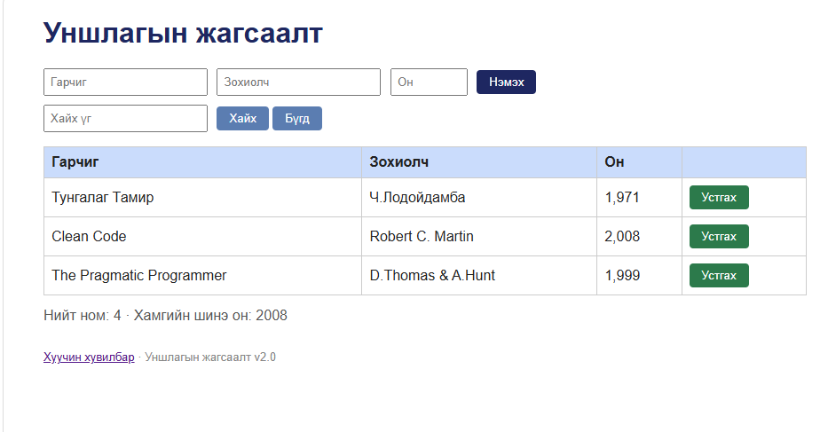

# BUG-03: Устгах товчнууд улаан биш, ногоон өнгөтэй

Орчин: Уншлагын жагсаалт v2.0, Windows, Microsoft Edge 155.0.4283.62 (64-bit), 2026-10-19.

Урьдчилсан нөхцөл: `node app.js` серверийг шинээр асаасан, анхны гурван номтой төлөв.

## Дахин гаргах алхам

1. Браузераар `http://localhost:3000` хаягийг нээнэ.
2. **Бүгд** товчийг дарна.
3. Номын мөрүүдийн **Устгах** товчны өнгийг ажиглана.

## Хүлээгдсэн үр дүн

Спецификацийн дагуу аюултай үйлдлийн **Устгах** товч улаан өнгөтэй байна.

## Бодит үр дүн

Гурван номын **Устгах** товч ногоон өнгөтэй харагдав.

Ноцтой байдал: **Cosmetic** — аюултай үйлдлийн товчны өнгө шаардлагад нийцэхгүй байна.

Олдсон аялал: **Supermodel**.

## Нотолгоо

BUG-01-ийн баталгаажуулалтын зурагт товчнуудын өнгө мөн харагдана.

