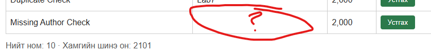
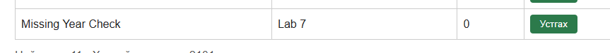

# BUG-04: Заавал бөглөх талбар хоосон байхад ном нэмэгддэг

Орчин: v2.0, Windows, Edge 155.0.4283.62, 2026-10-19.
Урьдчилсан нөхцөл: node app.js-ийг шинээр асаасан, анхны 3 номтой.

## Дахин гаргах алхам
1. http://localhost:3000 нээнэ.
2. Гарчиг `Missing Author Check`, зохиолч хоосон, он `2000` оруулаад Нэмэх дарна.
3. Серверийг дахин шинээр асаана.
4. Гарчиг `Missing Year Check`, зохиолч `Lab 7`, он хоосон оруулаад Нэмэх дарна.

Хүлээгдсэн: Аль ч тохиолдолд ном нэмэгдэхгүй, дутуу талбарыг тайлбарласан алдаа харуулна.
Бодит: Хоёр тохиолдолд ном нэмэгдсэн. Хоосон оныг 0 гэж харуулсан.

Ноцтой байдал: Major — шаардлагатай мэдээлэлгүй өгөгдөл хадгалж байна.
Олдсон аялал: Couch Potato.

