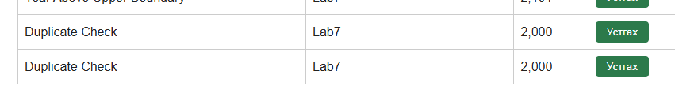

# BUG-05: Ижил гарчиг, зохиолчтой ном давхар нэмэгддэг

Орчин: v2.0, Windows, Edge 155.0.4283.62, 2026-10-19.
Урьдчилсан нөхцөл: node app.js-ийг шинээр асаасан, анхны 3 номтой.

## Дахин гаргах алхам
1. http://localhost:3000 нээнэ.
2. `Duplicate Check`, `Lab7`, `2000` утгаар ном нэмнэ.
3. Яг ижил утгаар дахин нэмнэ.

Хүлээгдсэн: Спецификацийн дагуу хоёр дахь нэмэлтийг хүлээн авахгүй.
Бодит: Хоёр ижил мөр үүссэн.

Ноцтой байдал: Major — давхардсан өгөгдөл үүсгэж байна.
Олдсон аялал: Couch Potato-ийн дараах нэмэлт шалгалт.

