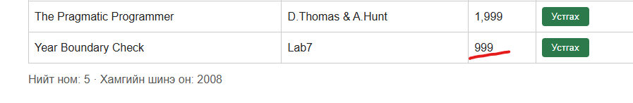
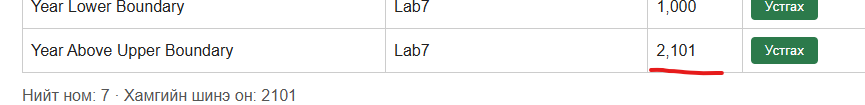

# BUG-06: Зөвшөөрөгдсөн хязгаараас гадуурх оныг хүлээн авдаг

Орчин: v2.0, Windows, Edge 155.0.4283.62, 2026-10-19.
Урьдчилсан нөхцөл: Хувилбар бүрийг серверийг шинээр асаасан төлөвөөс шалгана.

## Дахин гаргах алхам
1. http://localhost:3000 нээнэ.
2. `Year Boundary Check`, `Lab7`, `999` утгаар ном нэмнэ.
3. Серверийг дахин шинээр асаана.
4. `Year Above Upper Boundary`, `Lab7`, `2101` утгаар ном нэмнэ.

Хүлээгдсэн: Он 1000–2100 хооронд байх ёстой тул хоёр нэмэлтийг хүлээн авахгүй.
Бодит: 999 болон 2101 онтой номууд нэмэгдсэн.

Ноцтой байдал: Major — зөвшөөрөгдөөгүй өгөгдөл хадгалж байна.
Олдсон аялал: Couch Potato-ийн дараах хязгаарын утгын шалгалт.

