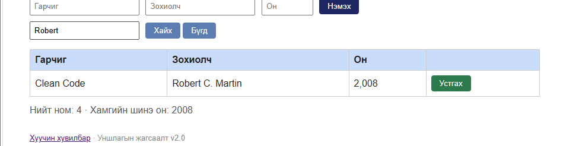
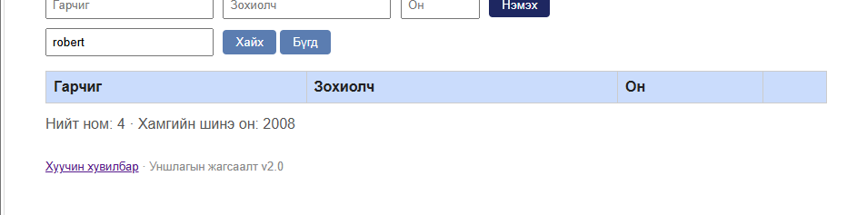

# BUG-07: Хайлт том, жижиг үсэг ялгадаг

Орчин: v2.0, Windows, Edge 155.0.4283.62, 2026-10-19.
Урьдчилсан нөхцөл: node app.js-ийг шинээр асаасан, анхны 3 номтой.

## Дахин гаргах алхам
1. http://localhost:3000 нээнэ.
2. Robert гэж оруулаад Хайх дарна.
3. Бүгд дараад robert гэж хайна.

Хүлээгдсэн: Үсгийн хэмжээ ялгахгүй; хоёр хайлтаар Clean Code олдоно.
Бодит: Robert хайлтаар олдсон, robert хайлтаар олдоогүй.

Ноцтой байдал: Major — байгаа номыг үсгийн хэмжээнээс шалтгаалан олохгүй байна.
Олдсон үе: Нэмэлт хайлтын шалгалт.

