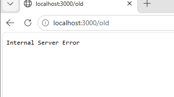

# BUG-08: Хуучин хувилбар холбоос серверийн алдаа харуулдаг

Орчин: v2.0, Windows, Edge 155.0.4283.62, 2026-10-19.
Урьдчилсан нөхцөл: node app.js-ийг шинээр асаасан.

## Дахин гаргах алхам
1. http://localhost:3000 нээнэ.
2. Доорх Хуучин хувилбар холбоосыг дарна.

Хүлээгдсэн: Спецификацийн дагуу бүх холбоос ажиллах; холбоосын хуудас алдаагүй нээгдэх.
Бодит: Internal Server Error гэсэн бичвэр харагдсан.

Ноцтой байдал: Major — холбоосоор зорьсон хуудсыг нээх боломжгүй.
Олдсон үе: API шалгалтын дараах нэмэлт хайгуул; тусгай tour тэмдэглээгүй.

